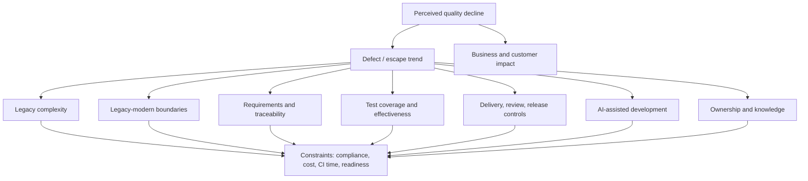

# Problem Discovery Map

**Version:** v0 | **Date:** 2026-10-22

Map of problem domains, current hypotheses, the evidence that would confirm or reject them, and the sources to use. All hypotheses start at **Low** confidence.

## 1. Map overview

## 2. Domains and hypotheses

| # | Domain | Hypothesis | Confirming evidence | Rejecting evidence | Sources |
|---|---|---|---|---|---|
| 1 | Business impact | H-01: Quality issues cause measurable customer impact (escalations, churn risk, SLA breach). | Rising escalations linked to defects | No customer-visible trend | Jira CFB, support, Product |
| 2 | Defect patterns | H-02: Escaped defects per change increased over 18-24 months. | Normalized upward trend | Flat or down trend; reporting change explains it | Jira, Power BI |
| 3 | Legacy complexity | H-03: A small set of monolith modules produces a large share of defects. | Pareto concentration in hotspots | Even spread | Git, Jira, Sonar |
| 4 | Boundaries | H-04: Defects cluster at legacy-modern integration points. | Defect / incident root causes at interfaces | Root causes inside single components | RCAs, Jira, architecture docs |
| 5 | Requirements | H-05: Escaped defects often trace to missing or unclear requirements. | RCA root-cause category; low traceability | Root causes mostly implementation | Jira, Xray, RCAs |
| 6 | Testing | H-06: Tests do not cover the areas where defects escape. | Escapes in low-coverage / no-test areas | Escapes in well-tested areas (then test effectiveness, not coverage) | Xray, Sonar, CI |
| 6b | Test reliability | H-07: Flaky / skipped tests reduce trust in CI signals. | High rerun, skip, quarantine rates | Stable pipelines | CI/CD |
| 7 | Delivery / review | H-08: Larger or faster changes get shallower review. | PR size vs review time / comments; escape correlation | No correlation | Git PR data |
| 8 | Existing signals | H-09: Existing tools (Sonar, Xray, CI) produce signals that are not acted on. | Ignored gate failures, overridden checks | Signals acted on | Sonar, CI, Jira |
| 9 | Production | H-10: Change-induced incidents increased. | Incident-to-deploy linkage trend | Incidents not change-related | Incident system, observability |
| 10 | AI-assisted dev | H-11: AI-assisted changes have higher defect / revert rate or weaker review. | Rate difference with control for size and area | No difference; decline predates adoption | Git, AI telemetry, survey |
| 11 | Knowledge | H-12: Critical areas depend on 1-2 people. | Ownership concentration + SME interviews | Broad ownership | Git blame/log, interviews |
| 12 | Constraints | - | Documented compliance, privacy, cost, CI duration limits | - | Security, DevOps, finance |

## 3. Cross-cutting questions

- Is the "decline" real, or a measurement artifact? (Check before any root-cause work.)
- Is risk concentrated (Pareto) or diffuse? The answer changes the solution class.
- Do hypotheses H-03 to H-11 compete or compound?

## 4. Status

| Hypothesis | Status | Confidence | Last update |
|---|---|---|---|
| H-01 to H-12 | Not tested | Low | 2026-10-22 |
